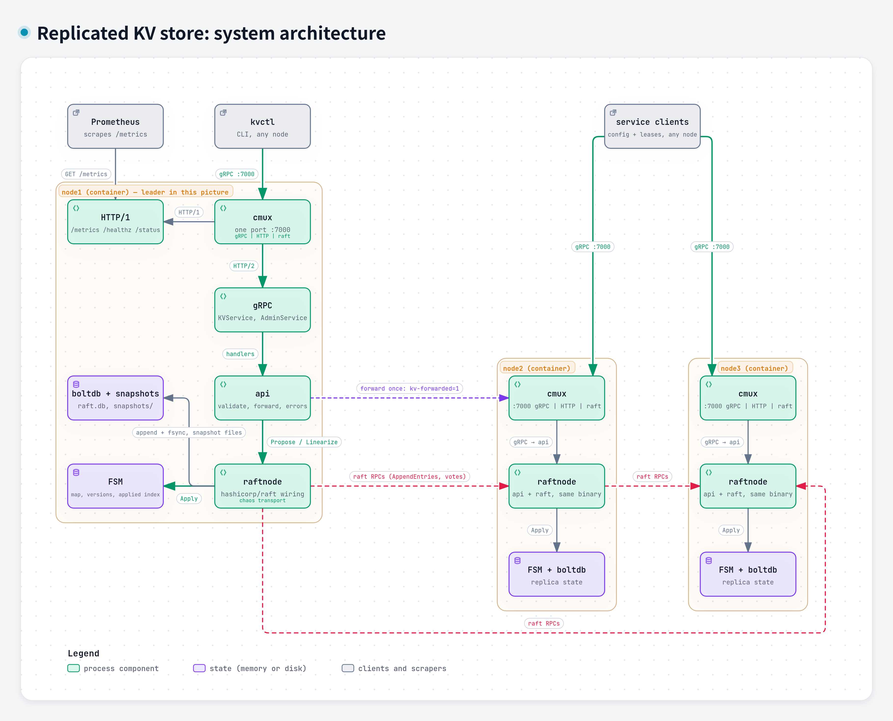

# kvstore: a replicated key-value store on Raft

[](https://github.com/Ehsan-saradar/euler-phi-exercise-d33/actions/workflows/ci.yml)
[](https://github.com/Ehsan-saradar/euler-phi-exercise-d33/actions/workflows/e2e.yml)
[](https://github.com/Ehsan-saradar/euler-phi-exercise-d33/actions/workflows/chaos.yml)
[](https://github.com/Ehsan-saradar/euler-phi-exercise-d33/actions/workflows/codeql.yml)

EulerPhi take-home, **D3.3 Replicated key-value store**: a small, strongly
consistent store for critical config and leases, similar to etcd.

| Tier | Requirement | Where it is proven |
|------|-------------|--------------------|
| Core | 3-node cluster using Raft | `docker compose up`; [`test/integration/cluster_test.go`](test/integration/cluster_test.go) |
| Core | every read sees the latest committed write | ReadIndex read gate ([ADR 003](docs/adr/003-linearizable-reads.md)); Porcupine check |
| Core | survives one node failure | `TestLeaderFailoverKeepsAcknowledgedWrites`, e2e `kill leader` |
| Senior | leader failover with no lost committed writes | same tests, both read modes |
| Senior | partition test, minority refuses writes | `TestMinorityPartitionRefusesWrites`, `TestIsolatedFollowerAnswersUnavailable`, e2e |
| Senior | snapshots and log compaction | `TestSnapshotCompactionAndCatchUp` (restore from `InstallSnapshot`, restart from snapshot + log tail) |
| Stretch | randomized fault testing checked with Porcupine | `make chaos`, results in [`docs/chaos/RESULTS.md`](docs/chaos/RESULTS.md) |

Design document: [`docs/design.md`](docs/design.md). Decisions: [`docs/adr/`](docs/adr/).

## Quick start

```bash
docker compose up --build -d --wait     # three nodes on localhost:7001..7003
go build -o bin/kvctl ./cmd/kvctl

bin/kvctl -addr localhost:7001 put greeting "hello phi"
bin/kvctl -addr localhost:7003 get greeting            # linearizable, any node
bin/kvctl -addr localhost:7003 get -stale greeting     # local replica, may lag
bin/kvctl -addr localhost:7002 cas greeting 1 "hello again"
bin/kvctl -addr localhost:7002 range greet
bin/kvctl -addr localhost:7001 status

./scripts/demo.sh        # failover, partition and snapshot walkthrough
./scripts/chaos.sh       # docker-level kill / pause / partition loop
```

`grpcurl -plaintext localhost:7001 list` works too (server reflection), and
plain HTTP on the same port serves `/healthz`, `/status` and `/metrics`
(Prometheus, including hashicorp/raft's internal timings).

## Architecture



One process per node, **one TCP port per node** (cmux demultiplexes gRPC,
HTTP/1 and raft traffic). Packages:

| Package | Responsibility |
|---------|----------------|
| `internal/fsm` | deterministic state machine: put / delete / compare-and-swap with per-key versions, prefix ranges, streamed protobuf snapshots, own applied index |
| `internal/raftnode` | hashicorp/raft wiring, bootstrap, `Propose`, the `Linearize` read gate, membership, chaos transport (`ChaosLayer`: block peers, freeze traffic), Prometheus collector |
| `internal/api` | `KVService` and `AdminService`, leader forwarding (one hop, loop-safe), the NOT_APPLIED error contract, metrics |
| `internal/server` | cmux, gRPC server, health, reflection, HTTP endpoints |
| `internal/cluster` | in-process N-node harness used by integration and chaos tests |
| `cmd/kvnode`, `cmd/kvctl`, `cmd/kvbench` | node binary, CLI, load generator |
| `proto/kv/v1` | API, log command and snapshot schema (generated code committed in `gen/`) |

All diagrams are made with Archify. The process flows (write, linearizable
read, failover, partition, snapshot) are in [`docs/diagrams/`](docs/diagrams/);
the design document embeds the read and partition flows and links the rest.

### Write path

1. Client calls `Put` on any node. A follower forwards to the leader (gRPC,
   marked so it is never forwarded twice).
2. The leader encodes a protobuf `Command`, appends it to its log (boltdb,
   fsync) and replicates it. Once a majority has it, the entry is committed.
3. The FSM applies it, bumps the key's version and answers through the raft
   future. The response carries the raft index and term.

### Linearizable read path (ReadIndex)

1. Follower forwards to the leader.
2. Once per term the leader commits a barrier (Raft §8: a leader may only
   serve reads after committing an entry of its own term).
3. `VerifyLeader`: one heartbeat round confirms a majority still follows this
   leader in this term.
4. The read waits until the FSM has applied the commit index, then reads
   locally. No disk write, one network round trip.

`CONSISTENCY_STALE` skips all of this and reads the local replica.

### Failure handling

| Event | Behaviour |
|-------|-----------|
| follower dies | nothing visible; it catches up from the log, or from a snapshot if the log was compacted |
| leader dies | followers elect a new leader after the election timeout (1 s in compose, 100 ms in tests); acknowledged writes survive because they were on a majority; in-flight writes get `DeadlineExceeded` (unknown) |
| leader isolated (minority) | it loses its lease, steps down, and answers `Unavailable` + `NOT_APPLIED`; the majority elects a new leader; after healing it discards its uncommitted tail |
| follower isolated | its forwards fail; it answers `Unavailable`; stale reads keep working |
| process pause / GC stall | peers see silence; same as isolation; a frozen leader cannot serve reads because `VerifyLeader` fails |
| disk full / corrupt | boltdb write fails, the node crashes; others continue |

Error contract ([ADR 005](docs/adr/005-error-contract.md)): `Unavailable` with
reason `NOT_APPLIED` means "nothing happened, retry anywhere";
`DeadlineExceeded` means "unknown, read back before retrying".

## Tests

```bash
make test               # unit + integration under the race detector (~30 s)
make test-docker        # same suite in a golang container (any OS)
make chaos              # randomized kill / partition / freeze + Porcupine (~30 s)
docker compose up -d --wait && go test -tags e2e ./test/e2e/   # real containers
make lint               # golangci-lint + buf lint
```

- `internal/fsm`: table tests for every operation, version rules, pagination,
  snapshot round trip, malformed entries, waiter semantics.
- `test/integration`: real nodes in one process on distinct loopback
  addresses: write/read anywhere, forwarding, failover in both read modes,
  restart from disk, minority partition, isolated follower, snapshot and
  catch-up through `InstallSnapshot`, join of a fourth node.
- `test/linearizability`: clients run put / get / cas through random nodes
  while a nemesis kills, partitions and freezes nodes; the history is checked
  by Porcupine against a per-key versioned register model. Unknown outcomes
  are modelled as "may happen later", so a violation is never masked.
- `test/e2e`: the compose cluster with `docker compose kill` / `pause`.

## Configuration

All settings are `KV_*` environment variables (see `docker-compose.yml`).

| Variable | Default | Meaning |
|----------|---------|---------|
| `KV_NODE_ID` | `node1` | raft server id |
| `KV_LISTEN` | `0.0.0.0:7000` | bind address (raft + gRPC + HTTP) |
| `KV_ADVERTISE` | peers[id] | address peers and clients dial |
| `KV_PEERS` | | `id=addr,...` static bootstrap configuration |
| `KV_BOOTSTRAP` | true if peers set | call `BootstrapCluster` (idempotent) |
| `KV_DATA_DIR` | `/data` | boltdb log + snapshots |
| `KV_HEARTBEAT_TIMEOUT` / `KV_ELECTION_TIMEOUT` / `KV_LEADER_LEASE_TIMEOUT` | 500ms / 1s / 400ms | raft timers |
| `KV_SNAPSHOT_THRESHOLD` / `KV_TRAILING_LOGS` | 8192 / 10240 | snapshot every N entries; keep N entries after a snapshot |
| `KV_READ_MODE` | `read_index` | `read_index` or `barrier` |
| `KV_APPLY_TIMEOUT` | 5s | bound on enqueueing a proposal |
| `KV_LEADER_WAIT` | 2s | how long a follower waits for a leader before `Unavailable` |
| `KV_LOG_LEVEL` | info | slog level |

## Key trade-offs

- **Library Raft, own everything else.** hashicorp/raft gives elections,
  replication, snapshots and membership; the project's value is the state
  machine, the read gate, the failure semantics, the tests and the write-up.
  etcd/raft would have been more "literal" and roughly twice the code.
- **ReadIndex instead of lease reads.** One heartbeat round per linearizable
  read, no clock assumptions. Lease reads are the obvious 10x optimisation and
  are described in the design doc.
- **Forward to the leader instead of redirecting.** Clients stay trivial
  (hit any node); the cost is one extra hop for 2/3 of requests.
- **In-memory FSM with streamed snapshots.** Fine for config-sized data
  (tens of MB); an on-disk FSM is the path for larger data sets.
- **Fault injection in the transport, not in the network.** Deterministic,
  unprivileged, identical in tests and demos; it cannot simulate packet loss
  or latency, which the design doc lists as future work.

## Known limitations

- No authentication, TLS or multi-tenancy.
- Linearizable reads are served only by the leader (followers forward);
  follower ReadIndex is not implemented.
- `Range` sorts matches on every call (O(n log n) over matching keys); fine
  for a config store, not for millions of keys.
- One raft group: write throughput is bounded by one leader's fsync rate.
- Leases/TTL and watch are designed (see design doc) but not implemented.
- `CompareAndSwap` compares `version`, which restarts at 1 when a key is
  deleted and recreated (ABA); comparing `mod_index` is the fix.
- The in-process harness binds `127.0.1.N` loopback aliases, which works on
  Linux out of the box; on macOS run `make mac-aliases` once (sudo) or use
  `make test-docker`.

## AI tools used

- **Claude Code (Claude Fable 5.1)**, used for planning, scaffolding, writing
  the implementation, tests, scripts and documentation under direction, and
  for reviewing lint and test output. Every line was read and is explained in
  the live review by the author.
- No other AI tools.

## Time spent

See [`docs/TIMELOG.md`](docs/TIMELOG.md) for the log.

## License

MIT.
