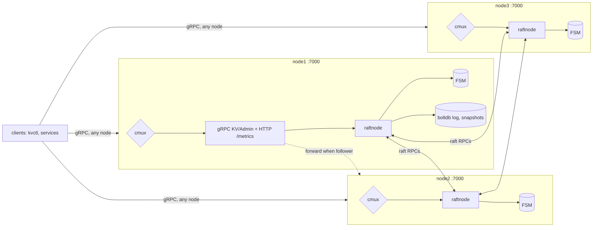
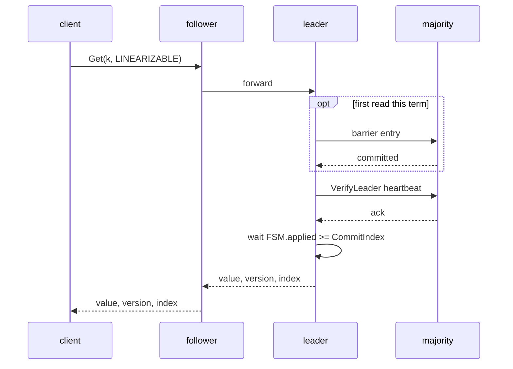

# Design: a replicated key-value store for Phi's config and leases

EulerPhi take-home, D3.3. Author: Ehsan Saradar. Date: 2026-10-28.
Code: `github.com/Ehsan-saradar/euler-phi-exercise-d33`.

## 1. Problem and scope

Phi needs a small, strongly consistent store, in the role etcd plays for
Kubernetes: service configuration, feature flags, rate-limit rules, worker-ID
and gateway leases, leader election for background jobs. The data is small
(megabytes), read far more often than written, and every reader must be able
to trust what it reads: a stale feature flag or a lease that two workers both
believe they hold is a correctness bug, not a performance issue.

Goals, in the exercise's words: a 3-node Raft cluster; every read sees the
latest committed write; survives one node failure; leader failover loses no
committed write; a minority partition refuses writes; snapshots and log
compaction; randomized fault testing checked with Porcupine.

Non-goals: multi-tenancy, authentication/TLS, multi-group sharding,
cross-region replication. Leases and watch are designed (section 9) but not
implemented; they are the rehearsed live-review change.

## 2. Architecture

Three identical processes. Each node listens on **one TCP port**; `cmux`
demultiplexes gRPC (clients and forwarded requests), HTTP/1 (`/metrics`,
`/healthz`, `/status`) and hashicorp/raft's own protocol. Because the raft
advertise address is also the API address, a follower can forward to the
leader using the address raft already knows, and `Join` needs one address.

| Layer | Package | Responsibility |
|-------|---------|----------------|
| API | `internal/api` | gRPC `KVService` / `AdminService`; validation; forwarding to the leader (one hop, loop-safe); the error contract; metrics |
| Consensus glue | `internal/raftnode` | hashicorp/raft wiring, bootstrap, `Propose`, the `Linearize` read gate, membership, the chaos transport |
| State machine | `internal/fsm` | deterministic apply of `Command`s; per-key versions; prefix range; streamed snapshots; its own applied index |
| Storage | raft-boltdb, file snapshot store | log + stable store with fsync; snapshots as files |
| Node | `internal/server`, `cmd/kvnode` | cmux, gRPC/HTTP servers, Prometheus registry, config from `KV_*` env |

Why a library Raft ([ADR 001](adr/001-go-and-hashicorp-raft.md)): the
exercise allows it, and the interesting engineering is above consensus: the
read path, failure semantics, snapshot format, fault injection and proof.
hashicorp/raft is used by Consul, Nomad and Vault; its API is small enough to
defend line by line.

## 3. Data model and API

A key maps to `{value, version, create_index, mod_index}`. `version` starts
at 1 and increments on every write of that key; `mod_index` is the raft index
of the last write, which doubles as a cluster-wide logical clock. Both are
returned to clients, so a compare-and-swap on `version` gives optimistic
concurrency without transactions, and `mod_index` lets a client know how
fresh a stale read is.

| RPC | Semantics |
|-----|-----------|
| `Put(key, value)` | replace; returns the new `KeyValue` |
| `Get(key, consistency)` | `LINEARIZABLE` (default) or `STALE` |
| `Delete(key)` | returns whether the key existed |
| `Range(prefix, start_after, limit, consistency)` | sorted, cursor-paginated |
| `CompareAndSwap(key, expected_version, value)` | `expected_version = 0` means "create only" |
| `Admin.Status / Join / Leave / Partition / Snapshot` | introspection, membership, fault injection |

Protobuf is used three times with one schema ([ADR 002](adr/002-grpc-protobuf-single-port.md)):
on the wire, as the raft log `Command` (`oneof put | delete | cas`), and as the
snapshot stream (`SnapshotHeader` followed by length-prefixed `KeyValue`
records). Adding an operation is a new field number; old log entries and
snapshots stay decodable, which is what makes rolling upgrades of a
state-machine possible.

## 4. Consistency model

### Writes

`Propose` marshals the command and calls `raft.Apply`. The leader appends to
its boltdb log (fsync), replicates, and once a majority has persisted the
entry it is committed and applied to the FSM in a single goroutine, in log
order. The client's response carries the FSM result (for example whether a
CAS matched) and the entry's index and term. Followers forward writes to the
leader over gRPC; the forwarded request is tagged so a leadership change
during the hop produces an error rather than a second hop.

### Linearizable reads: ReadIndex

A read served from a replica's map is linearizable only if (a) the serving
node is still the leader of the current term and (b) its state machine has
applied everything committed before the read began. [ADR 003](adr/003-linearizable-reads.md)
describes the implementation; the steps are:

1. **Once per term, commit a barrier entry.** Raft §8: a new leader does not
   know the true commit index until it has committed an entry of its own term
   (hashicorp/raft appends a noop, but the leader's `CommitIndex()` only
   reflects it once committed). Memoised per term.
2. **`VerifyLeader()`**: one heartbeat round; a majority confirms it still
   follows this leader in this term. Then re-check the term.
3. `commit := CommitIndex()`.
4. **Wait until the FSM's own applied index reaches `commit`.** This is the
   subtle part: `raft.AppliedIndex()` advances when an entry is *handed* to
   the FSM goroutine, not when it is applied, and noop/barrier/configuration
   entries never reach `FSM.Apply` at all. The FSM therefore tracks its own
   index, and if it lags `commit` the gap is scanned in the log store for the
   highest *command* entry; if there is none, the FSM is already current.
5. Read the map and answer with `commit` in the header.

Cost: one network round trip, no disk write. `KV_READ_MODE=barrier` keeps the
trivially correct alternative (a log entry per read) for comparison; the
failover test runs in both modes.

### Stale reads

`CONSISTENCY_STALE` reads the local map on any node with no coordination and
returns the FSM applied index. It is the right choice for a config cache that
re-validates by index, and it is what keeps working on the minority side of
a partition.

### Error contract

A client of a replicated store must know whether a failed write may have
happened ([ADR 005](adr/005-error-contract.md)):

| Status | Meaning | Client action |
|--------|---------|---------------|
| `Unavailable` + `ErrorInfo.reason = NOT_APPLIED` | produced by the node before the proposal reached the log (no leader, lost leadership before enqueue, dial failure) | retry on any node |
| `DeadlineExceeded` | the entry was enqueued and leadership was lost, the leader became unreachable after forwarding, or the client deadline fired | read back, then retry |
| `Unavailable` without the marker | transport failure after the request may have been sent | treat as unknown (except `connection refused`, which never left the client) |

The Porcupine checker relies on this distinction (section 7).

## 5. Storage, snapshots, compaction

- **Log and stable store**: `raft-boltdb` (one B+tree file, fsync per
  batch). Every committed entry is durable on a majority before it is
  acknowledged.
- **State machine**: an in-memory map guarded by an RWMutex; entries are
  immutable once stored, so a snapshot can share them.
- **Snapshot**: `FSM.Snapshot` copies the map's pointers under the read lock
  (O(keys), microseconds for config-sized data) so raft can resume applying;
  `Persist` then streams header + records through a buffered writer off the
  raft loop. Memory stays flat regardless of key count; a corrupt length
  prefix is bounded at 64 MiB per record.
- **Trigger**: `SnapshotThreshold` entries since the last snapshot (8192 in
  compose) or `SnapshotInterval`, plus `Admin.Snapshot` on demand.
- **Compaction**: after a snapshot, raft keeps `TrailingLogs` entries (10240)
  so a slightly lagging follower catches up from the log; one that fell
  behind the compaction point receives `InstallSnapshot` and calls
  `FSM.Restore`, which replaces the map and sets the applied index from the
  header. `TestSnapshotCompactionAndCatchUp` exercises exactly this with a
  threshold of 64 and 8 trailing entries, then restarts the node from disk to
  prove snapshot + log tail rebuild the same state.
- **On disk per node**: `raft.db` (log + votes/term) and `snapshots/<id>/`
  (`meta.json` + `state.bin`); the two most recent snapshots are retained.

## 6. Failure handling

| Failure | What happens | What clients see |
|---------|--------------|------------------|
| Follower crash | no quorum impact; on restart it replays its log, then catches up from the leader's log or a snapshot | nothing, except requests sent to that node fail with `connection refused` |
| Leader crash | followers time out (1 s in compose, 100 ms in tests), elect the candidate with the most complete log; it commits a noop, then serves | acknowledged writes are all present (they were on a majority); in-flight writes get `DeadlineExceeded`; `TestLeaderFailoverKeepsAcknowledgedWrites`, e2e `kill leader` |
| Leader isolated (minority) | cannot reach a majority: its lease (`LeaderLeaseTimeout`, 400 ms) expires and it steps down; pending proposals fail; the majority elects a new leader at a higher term; on heal the old leader's uncommitted tail is truncated | writes on the minority return `Unavailable NOT_APPLIED` (after step-down) or `DeadlineExceeded` (enqueued before); never success. Linearizable reads fail (`VerifyLeader` cannot get a majority); stale reads still answer. `TestMinorityPartitionRefusesWrites`, e2e |
| Follower isolated | its forwards time out after `KV_LEADER_WAIT` | `Unavailable NOT_APPLIED`; stale reads work; converges after heal |
| Process pause / long GC | indistinguishable from isolation to peers; a paused leader is deposed and, on resume, its `VerifyLeader` fails until it learns the new term | as above; `freeze-*` faults in the chaos suite, `docker compose pause` in e2e |
| Clock jumps | raft uses monotonic timers only; no wall clock enters the protocol or the FSM | none |
| Disk full / I/O error | boltdb write fails; hashicorp/raft panics the node; the other two continue | that node is down (see follower crash) |
| Two nodes down | no quorum: no leader, no writes, no linearizable reads; stale reads continue | `Unavailable NOT_APPLIED` until a node returns |

Fault injection ([ADR 004](adr/004-fault-injection.md)) lives in the raft
transport: `ChaosLayer` can block peers (refuse dials, drop inbound by IP,
close live streams) and freeze all raft traffic. It is driven by
`Admin.Partition`, used by the in-process tests, and complemented by real
`docker compose kill / pause` in the e2e suite and `scripts/chaos.sh`.

## 7. Verification

| Suite | What it proves | Run |
|-------|----------------|-----|
| `internal/fsm` unit tests | every operation, version rules, pagination, snapshot round trip, malformed entries | `make test` |
| `test/integration` (real nodes in one process, race detector) | write/read anywhere; forwarding; failover in both read modes; restart from disk; minority partition; isolated follower; snapshot + `InstallSnapshot` catch-up; runtime join | `make test` |
| `test/linearizability` | Porcupine linearizability over histories recorded while a nemesis kills, partitions and freezes nodes | `make chaos` |
| `test/e2e` + `scripts/demo.sh` | the compose cluster with real container kills and pauses | `e2e` workflow |

**Porcupine.** Six clients issue `put` / `get` / `cas` on eight keys through
random nodes; the nemesis alternates faults (`kill-leader`, `kill-random`,
`isolate-leader`, `split-random`, `freeze-leader`, `freeze-random`) held for
1.5 s with 1 s of quiet between them. The model is a versioned register per
key (Porcupine partitions the history by key). Operations that returned
`NOT_APPLIED` are dropped (they had no effect); writes with an unknown outcome
are kept with an infinite return time, so the checker may place them anywhere
later, including "never observed", which is sound and still catches an
acknowledged write that is lost or a read that goes backwards. Three runs on
2026-10-28, all `Ok`:

| seed | ops checked | not applied (dropped) | unknown | faults |
|------|-------------|-----------------------|---------|--------|
| 590640475 | 2170 | 514 | 43 | 10 |
| 128828502 | 2390 | 718 | 98 | 12 |
| 116118318 | 2954 | 1061 | 153 | 12 |

A run with the first seed before the error contract was tightened recorded
324 unknown outcomes (dead-node `connection refused` counted as unknown) and
the checker timed out: the unknown count is the knob that makes the proof
tractable, which is why the contract matters beyond the client experience.
Visualizations are in `docs/chaos/` and the chaos workflow uploads them as
artifacts.

## 8. Capacity estimates

### Workload at Phi's scale

| Item | Year one (2M users) | 10x headroom |
|------|---------------------|--------------|
| config keys (flags, service config, rate-limit rules) | ~5k keys × ~2 KB = 10 MB | 50k keys, 100 MB |
| leases (gateway nodes, workers, job leaders), 5 s keep-alive | ~500 leases → 100 writes/s | 5k leases → 1k writes/s |
| config writes | tens per minute | hundreds per minute |
| config reads | every service instance caches and watches; validation reads ~100/s; bursts at deploy of ~10k | 1k/s steady, 100k burst |
| linearizable reads (lease checks, election) | ~500/s | 5k/s |

The store is write-light and read-heavy by design; keep-alives dominate
writes. A single raft group fits with a wide margin, as it does for etcd at
far larger clusters.

### Measured on one machine (3 containers, 8 vCPU VM, software-RAID disk with 7.6 ms fsync p50)

From `docs/bench/RESULTS.md`, 256-byte values, 1000 keys, clients spread over
all three nodes (so two thirds of requests take the forwarding hop):

| Operation | Clients | Throughput | p50 | p99 |
|-----------|---------|------------|-----|-----|
| put | 1 | 46 /s | 18.5 ms | 45 ms |
| put | 16 | 152 /s | 100 ms | 341 ms |
| put | 64 | 512 /s | 118 ms | 235 ms |
| get linearizable | 1 | 2.4k /s | 0.43 ms | 0.67 ms |
| get linearizable | 64 | 21.4k /s | 2.6 ms | 8.8 ms |
| get stale | 64 | 48k /s | 1.1 ms | 5.0 ms |
| mixed 50/50 | 32 | 388 /s | 84 ms | 174 ms |
| put, 4 KiB values | 16 | 140 /s | 107 ms | 214 ms |

Reading the numbers:

- **Writes are fsync-bound.** One client sees ~2 fsyncs (boltdb writes a
  data page and the meta page) on the leader, overlapped with the followers'
  own fsyncs: 18.5 ms ≈ 2 × 7.6 ms plus the forwarding hop. Raft's internal metrics on the leader
  agree: `leader_dispatchLog` (local append) p50 19 ms, `appendEntries` RPC
  p50 39 ms under 16 clients. Throughput rises with concurrency because
  hashicorp/raft batches up to `MaxAppendEntries` (64) proposals per fsync;
  at 64 clients, 512 writes/s ≈ 64 per ~120 ms batch. On a laptop NVMe
  (fsync ≈ 0.2 to 1 ms) the same code lands in the 2k to 10k writes/s range,
  which is where etcd sits.
- **Linearizable reads cost one heartbeat round and no disk**: ~0.4 ms alone,
  ~21k/s across the cluster at 64 clients, bounded by the leader's CPU and the
  forwarding hop. Stale reads are a local map lookup: ~50k/s and still
  climbing with clients.
- **Value size** barely matters at 4 KiB; the fsync dominates.

### Derived sizing

- **Write budget**: 1k keep-alive writes/s (10x case) on fsync-bound storage
  needs batches of ~8 per fsync at 8 ms, which 10 concurrent writers already
  provide; on NVMe it is idle. Lease keep-alives can also be coalesced per
  node (one entry renewing many leases) before the single group is a concern.
- **Log growth**: 1k writes/s × ~400 B ≈ 0.4 MB/s ≈ 35 GB/day *uncompacted*;
  with snapshots every 8192 entries (~8 s at that rate) and 10240 trailing
  entries, the log stays under ~8 MB and each snapshot is the data size
  (10 to 100 MB), written in well under a second.
- **Memory**: map entry ≈ key + value + ~120 B; 50k keys × 2 KB ≈ 110 MB per
  node plus one snapshot copy's worth of pointers. The in-memory FSM is
  comfortable to a few GB; beyond that, section 10.
- **Replication bandwidth**: 1k writes/s × 400 B × 2 followers ≈ 0.8 MB/s;
  heartbeats are negligible. Cross-zone links are not a factor.
- **Recovery times**: leader loss is detected within the election timeout
  (1 s) plus one election (tens of ms on a LAN); an isolated leader stops
  serving reads within the lease timeout (400 ms); a restarting node with a
  100 MB snapshot is serving stale reads within seconds and linearizable
  reads (forwarded) immediately.

## 9. Designed, not built: leases and watch

**Leases.** `LeaseService { Grant(ttl) → id, KeepAlive(id), Revoke(id) }`,
`Put(..., lease_id)`. Grants, keep-alives and revocations are log entries, so
the FSM's lease table is replicated. Expiry must also be a log entry: only the
leader runs a ticker, compares the deadline it recorded when it applied the
last keep-alive against its own monotonic clock, and proposes `Revoke`.
Followers never expire anything on their own clock, which keeps the state
machine deterministic. After a failover the new leader rebuilds deadlines
from the FSM and grants every lease a full TTL of grace, as etcd does.

**Watch.** A server-streaming `Watch(prefix, start_index)` served by any node
from its own FSM through an in-process broadcaster fed after every `Apply`;
`start_index` older than the current state replays from the log store, and
older than the last snapshot returns `compacted` (clients re-list). Watch is
eventually consistent by nature; readers that need linearizability do a
linearizable `Get` after the event.

## 10. What breaks at 10x and 100x

**10x.** Writes: fsync is the wall. Replace boltdb with `raft-wal`
(sequential appends, one fsync), put the log on a dedicated NVMe, and let
batching do the rest. Linearizable reads: each costs the leader a heartbeat
round; move to lease-based reads (skip the round within the leader lease,
which assumes bounded clock drift) or follower ReadIndex to spread the load.
`Range` sorts matches per call; a B-tree makes it O(log n + k). Snapshots copy
the map under a read lock; at tens of millions of keys that pause is visible,
so switch to a copy-on-write structure or an on-disk FSM whose snapshot is a
file copy.

**100x.** A single raft group is the ceiling: shard the key space over
multiple groups (multi-raft, as in TiKV and CockroachDB) behind a routing
table, and accept that cross-shard atomicity needs a transaction layer, which
is exactly why etcd stays single-group and small. Watch fan-out to many
thousands of subscribers needs a dedicated per-node broadcaster fed from the
log rather than the API goroutines. Smart clients that learn the leader (as
etcd's do) remove the forwarding hop. Five voters across zones with learners
in remote regions give local stale reads; cross-region commit latency then
bounds writes, which is fine for a store whose writes are rare by design.

**What does not change:** the proofs. Failover, partition and Porcupine
results hold per group; the error contract still tells a client whether a
failed write may have applied.

## 11. Trade-offs and limitations

- Library Raft over etcd/raft or hand-written: less code to defend, less
  control over the ready loop; `AppliedIndex` semantics had to be worked
  around in the FSM.
- Forwarding over redirecting: simple clients, one extra hop for 2/3 of
  requests.
- ReadIndex over lease reads: no clock assumption, one round trip per read.
- In-memory FSM: fast and simple up to a few GB; not for bulk data.
- Fault injection in the transport: deterministic and unprivileged, but it
  cannot model packet loss, reordering or latency; `tc netem` in the e2e
  suite is the natural extension.
- No TLS/auth, single raft group, no follower reads, no leases/watch yet.
