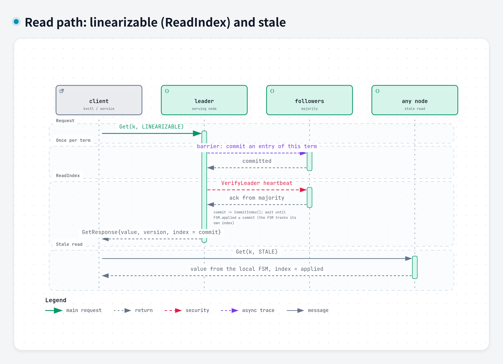
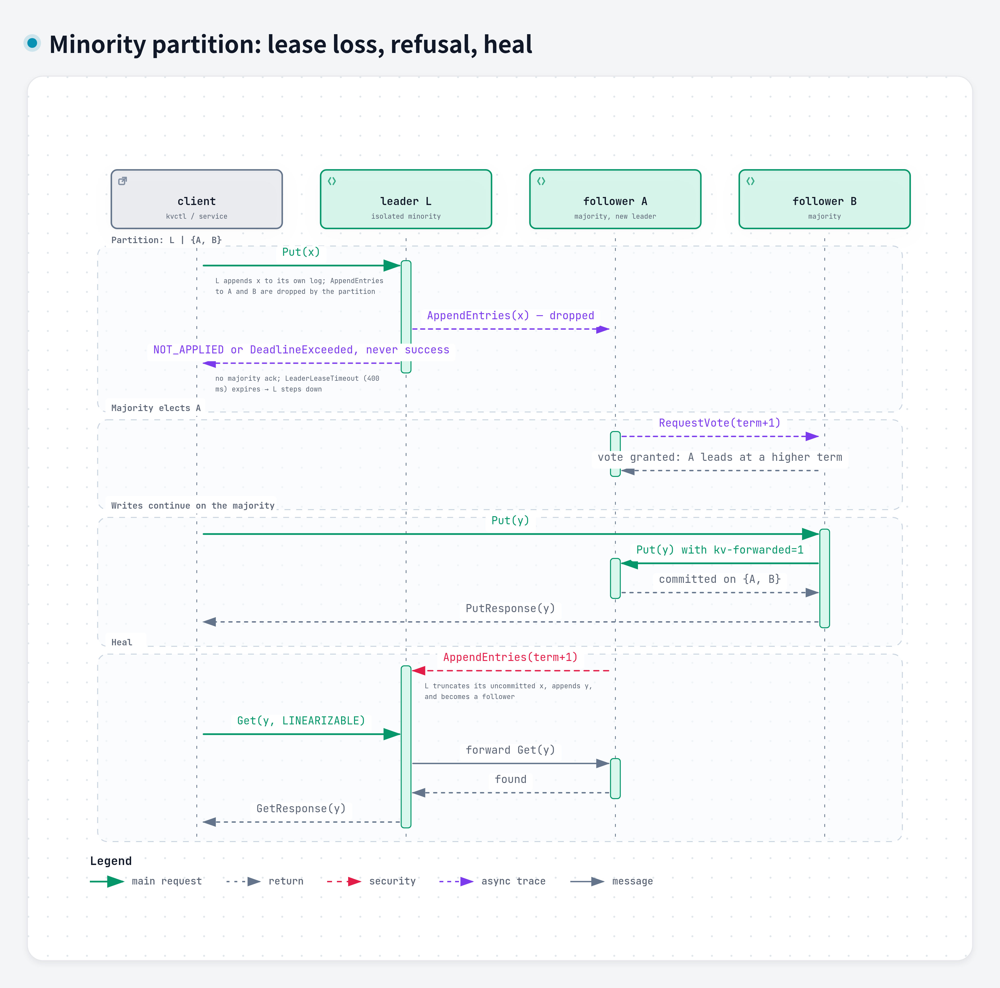

# Design: a replicated key-value store for Phi's config and leases

EulerPhi take-home, D3.3. Author: Ehsan Saradar. Date: 2026-10-28.
Code: `github.com/Ehsan-saradar/euler-phi-exercise-d33`.

## 1. Problem and scope

Phi needs a small, strongly consistent store in the role etcd plays for
Kubernetes: service config, feature flags, rate-limit rules, worker-ID and
gateway leases, leader election for background jobs. The data is small
(megabytes) and read far more than written, but every read must be
trustworthy: a stale flag or a lease two workers both believe they hold is a
correctness bug.

Goals: a 3-node Raft cluster; every read sees the latest committed write;
survives one node failure; no committed write lost on failover; a minority
partition refuses writes; snapshots and log compaction; randomized fault
testing checked with Porcupine. Non-goals: auth/TLS, multi-tenancy, sharding,
cross-region replication. Leases and watch are designed (section 8), not built.

## 2. Architecture

Three identical processes, each on **one TCP port**: `cmux` splits gRPC
(clients and forwarded requests), HTTP/1 (`/metrics`, `/healthz`, `/status`)
and hashicorp/raft's protocol. Because the raft address is also the API
address, a follower forwards to the leader using the address raft already
knows.

| Package | Responsibility |
|---------|----------------|
| `internal/api` | gRPC `KVService` / `AdminService`, validation, one-hop leader forwarding, error contract |
| `internal/raftnode` | hashicorp/raft wiring, `Propose`, the `Linearize` read gate, membership, chaos transport |
| `internal/fsm` | deterministic apply, per-key versions, prefix range, streamed snapshots, own applied index |
| storage | raft-boltdb (log + stable store, fsync), file snapshot store; consensus is hashicorp/raft ([ADR 001](adr/001-go-and-hashicorp-raft.md)) |

**Data model.** A key maps to `{value, version, create_index, mod_index}`.
RPCs: `Put`, `Get(consistency)`, `Delete`, `Range(prefix, start_after, limit)`,
`CompareAndSwap(expected_version)` (0 = create only), plus admin calls. One
protobuf schema serves the wire, the log `Command` and the snapshot records
([ADR 002](adr/002-grpc-protobuf-single-port.md)).

## 3. Consistency model

**Writes.** `Propose` calls `raft.Apply`; the leader appends to boltdb
(fsync), replicates, and once a majority has the entry it is committed and
applied in log order by one goroutine. The response carries the FSM result
and the entry's index. A follower forwards writes to the leader, tagging the
request so a leadership change mid-hop yields an error, never a second hop
([write flow](diagrams/flow-write.png)).

**Linearizable reads (ReadIndex, [ADR 003](adr/003-linearizable-reads.md)).**
A local read is linearizable only if the node is still leader of the current
term and its FSM has applied everything committed before the read began:

1. **Once per term, commit a barrier.** Raft §8: a new leader does not know
   the true commit index until an entry of its own term commits.
2. **`VerifyLeader()`**: one heartbeat round confirms a majority still
   follows this leader; then re-check the term.
3. **Wait until the FSM's own applied index reaches `CommitIndex()`.**
   `raft.AppliedIndex()` moves when an entry is *handed* to the FSM, and
   noop/barrier/config entries never reach `FSM.Apply`, so the FSM tracks its
   own index and the log gap is scanned for the last *command* entry.
4. Read the map; return the commit index in the response header.

Cost: one network round trip, no disk write. `KV_READ_MODE=barrier` (a log
entry per read) is kept as a reference; failover tests run in both modes.
`CONSISTENCY_STALE` reads the local map on any node with no coordination and
keeps working on the minority side of a partition.

**Error contract ([ADR 005](adr/005-error-contract.md)).** A client must know
whether a failed write may have happened:

| Status | Meaning | Client action |
|--------|---------|---------------|
| `Unavailable` + reason `NOT_APPLIED` | rejected before reaching the log (no leader, not leader, dial failure) | retry anywhere |
| `DeadlineExceeded` | enqueued, then leadership lost / leader unreachable / deadline fired | read back, then retry |
| `Unavailable` without the marker | transport failure after sending | treat as unknown |

## 4. Storage, snapshots, compaction

- The FSM is an in-memory map under an RWMutex; stored entries are immutable,
  so `FSM.Snapshot` copies only pointers (O(keys)) and raft resumes at once.
  `Persist` streams a header plus length-prefixed records off the raft loop,
  so memory stays flat; a corrupt length is capped at 64 MiB.
- A snapshot is taken every `SnapshotThreshold` entries (8192), on
  `SnapshotInterval`, or on `Admin.Snapshot`. Raft then keeps `TrailingLogs`
  (10240) entries so a slightly lagging follower catches up from the log; one
  behind the compaction point gets `InstallSnapshot` and `FSM.Restore`.
- `TestSnapshotCompactionAndCatchUp` drives this with a threshold of 64 and 8
  trailing entries, then restarts the node to prove snapshot + log tail
  rebuilds the same state ([snapshot flow](diagrams/flow-snapshot.png)).

## 5. Failure handling

| Failure | What happens | What clients see |
|---------|--------------|------------------|
| Follower crash | no quorum impact; on restart it replays its log, then catches up by log or snapshot | requests to that node fail (`connection refused`) |
| Leader crash | election after the timeout (1 s compose, 100 ms tests); the most complete log wins | acknowledged writes all present; in-flight writes `DeadlineExceeded` |
| Leader isolated | its lease (400 ms) expires and it steps down; majority elects a new leader; on heal its uncommitted tail is truncated | minority writes: `NOT_APPLIED` or `DeadlineExceeded`, never success; linearizable reads fail; stale reads work |
| Follower isolated, process pause, GC | same as isolation to peers; a resumed leader fails `VerifyLeader` until it learns the new term | `NOT_APPLIED` or `DeadlineExceeded`; stale reads work |
| Two nodes down | no quorum | `NOT_APPLIED`; stale reads only |

The [failover flow](diagrams/flow-failover.png) shows a leader crash step by
step. Fault injection ([ADR 004](adr/004-fault-injection.md)) is a `ChaosLayer` in
the raft transport: block peers (refuse dials, drop inbound, close streams)
and freeze all raft traffic, driven by `Admin.Partition`.

## 6. Verification

Unit tests cover the FSM; integration tests (race detector, real nodes in
one process) cover forwarding, failover in both read modes, restart from
disk, minority partition, snapshot catch-up and runtime join; the e2e suite
and `scripts/chaos.sh` use real `docker compose kill` (SIGKILL) and `pause`
(SIGSTOP) on the compose cluster.

**Porcupine.** Six clients run `put` / `get` / `cas` on eight keys through
random nodes while a nemesis cycles kill, isolate, split and freeze faults
on the leader or a random node (1.5 s on, 1 s off). In-process, "kill" is a
node shutdown and restart on the same data and "freeze" stalls the raft
transport; true SIGKILL/SIGSTOP are covered by the e2e suite. The model is a versioned register per key. `NOT_APPLIED`
operations are dropped; unknown-outcome writes get an infinite return time,
which is sound and still catches a lost acknowledged write or a read going
backwards. All recorded runs are `Ok`:

| seed | ops checked | not applied | unknown | faults |
|------|-------------|-------------|---------|--------|
| 590640475 | 2170 | 514 | 43 | 10 |
| 128828502 | 2390 | 718 | 98 | 12 |
| 116118318 | 2954 | 1061 | 153 | 12 |
| 119326092 | 4016 | 1389 | 84 | 8 |

Before the error contract was tightened, the first seed had 324 unknowns and
the checker timed out, so the contract also keeps the proof tractable.

## 7. Capacity estimates

**Workload at Phi's scale.** Keep-alives dominate writes; one raft group fits
with a wide margin.

| Item | Year one (2M users) | 10x headroom |
|------|---------------------|--------------|
| config keys | ~5k × 2 KB = 10 MB | 50k keys, 100 MB |
| leases, 5 s keep-alive | ~500 → 100 writes/s | 5k → 1k writes/s |
| config reads (services cache and re-validate) | ~100/s, ~10k burst at deploy | 1k/s, 100k burst |
| linearizable reads (lease checks, election) | ~500/s | 5k/s |

**Measured** (`docs/bench/RESULTS.md`; 3 containers on one 8 vCPU VM, disk
fsync p50 7.6 ms, 256 B values, clients spread over all nodes):

| Operation | Clients | Throughput | p50 | p99 |
|-----------|---------|------------|-----|-----|
| put | 1 | 46 /s | 18.5 ms | 45 ms |
| put | 64 | 512 /s | 118 ms | 235 ms |
| get linearizable | 1 | 2.4k /s | 0.43 ms | 0.67 ms |
| get linearizable | 64 | 21.4k /s | 2.6 ms | 8.8 ms |
| get stale | 64 | 48k /s | 1.1 ms | 5.0 ms |

- **Writes are fsync-bound**: 18.5 ms ≈ 2 boltdb fsyncs + the forwarding
  hop. Throughput scales with concurrency because hashicorp/raft batches up
  to 64 proposals per fsync. On NVMe (fsync 0.2 to 1 ms) expect 2k to 10k/s.
  The 10x budget (1k writes/s) needs ~8 entries per fsync batch, which 10
  concurrent writers provide; keep-alives can also be coalesced.
- **Linearizable reads** cost one heartbeat round and no disk (~21k/s);
  stale reads are a map lookup (~48k/s and rising).
- **Log and snapshots**: 1k writes/s × 400 B ≈ 35 GB/day uncompacted; with a
  snapshot every 8192 entries the log stays under ~8 MB and a snapshot is
  the data size (10 to 100 MB).
- **Memory** ≈ key + value + 120 B per entry (50k × 2 KB ≈ 110 MB per node);
  **replication** 1k/s × 400 B × 2 followers ≈ 0.8 MB/s; **recovery**: a new
  leader in ~1 s, an isolated leader stops reads within 400 ms.

## 8. Designed, not built: leases and watch

**Leases**: `Grant(ttl)`, `KeepAlive(id)`, `Revoke(id)`, `Put(..., lease_id)`,
all as log entries. Expiry is also a log entry: only the leader runs a timer
and proposes `Revoke`, so followers never expire on their own clock and the
FSM stays deterministic. A new leader grants every lease a full TTL of grace,
as etcd does. **Watch**: a server stream `Watch(prefix, start_index)` from
any node's FSM through an in-process broadcaster; an index older than the
last snapshot returns `compacted` and the client re-lists.

## 9. What breaks at 10x and 100x

**10x.** Writes hit fsync: move to `raft-wal` on dedicated NVMe and rely on
batching. Linearizable reads load the leader: lease reads (assumes bounded
clock drift) or follower ReadIndex. `Range` sorts per call: use a B-tree.
Snapshot pointer copies become visible pauses at tens of millions of keys:
use a copy-on-write structure or an on-disk FSM.

**100x.** One raft group is the ceiling: shard over many groups (multi-raft,
as TiKV and CockroachDB do), with a transaction layer for cross-shard
atomicity. That cost is why etcd stays single-group and small. Smart clients
that track the leader remove the forwarding hop; watch fan-out needs a
per-node broadcaster fed from the log. The proofs carry over per group.

## 10. Trade-offs and limitations

- Library Raft (less code, less control); forwarding instead of redirects
  (simple clients, one extra hop for 2/3 of requests); ReadIndex instead of
  lease reads (no clock assumption, one round trip); in-memory FSM (fine up
  to a few GB).
- Transport-level fault injection cannot model packet loss or latency
  (`tc netem` is the extension).
- `CompareAndSwap` compares `version`, which restarts at 1 when a key is
  deleted and recreated (ABA); comparing `mod_index` instead is the fix.
- No TLS/auth, single raft group, no follower reads, no leases/watch yet.
