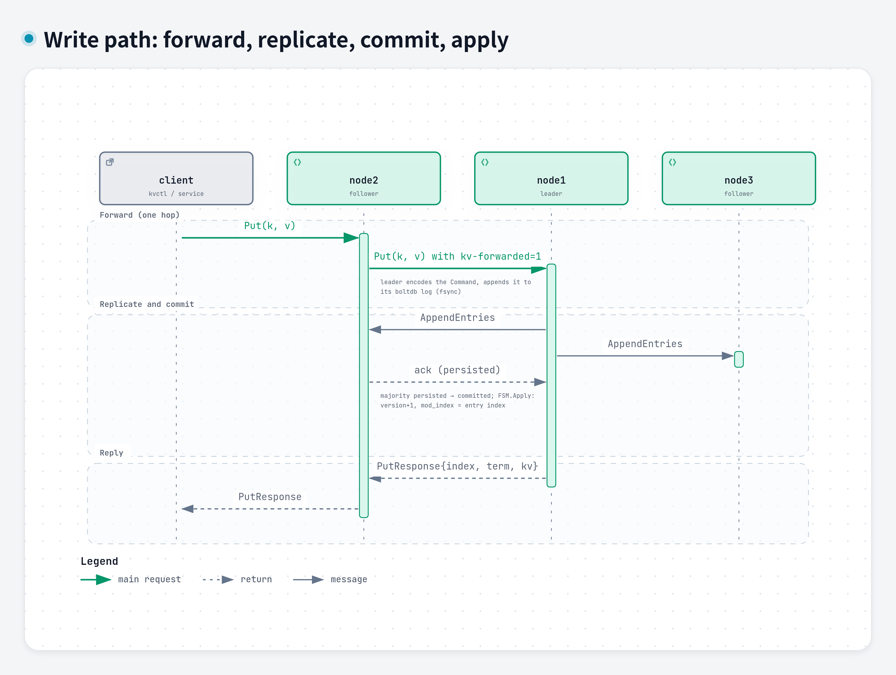
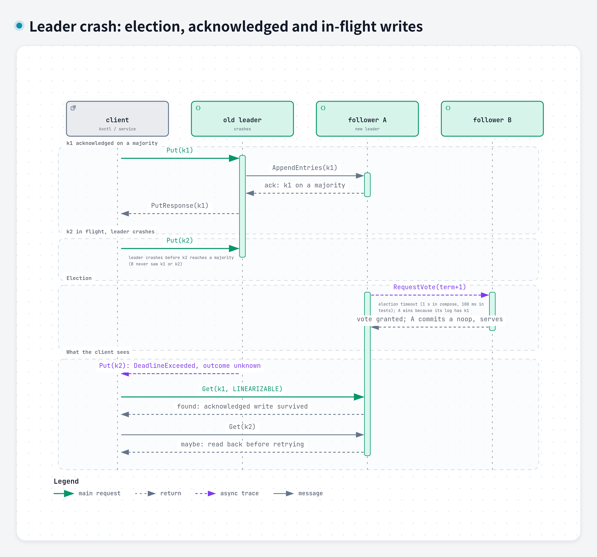
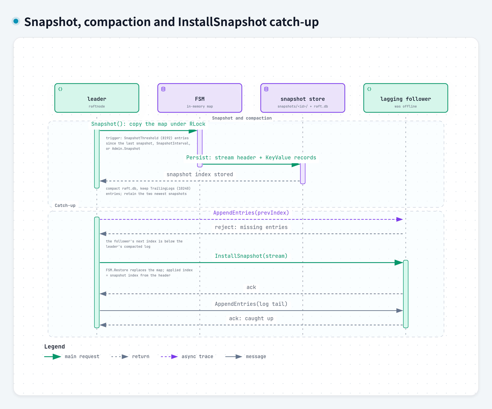

# Diagrams

The exercise requires diagrams made with **Archify** or **Diagram Design**.
These were made with [Archify](https://github.com/tt-a1i/archify) (v3.2):
each diagram is a typed JSON source in [`src/`](src/), validated against
Archify's schema, rendered to a standalone HTML viewer, checked in a real
browser, and then exported from the viewer as a 4x PNG (light theme) and a
dual-theme SVG. The design document, the README and the GitHub Pages build
use these exports.

| File | Source | Diagram |
|------|--------|---------|
| `architecture.png/.svg` | `src/architecture.architecture.json` | system architecture (clients, 3 nodes, one port each, raft links, storage) |
| `flow-write.png/.svg` | `src/flow-write.sequence.json` | write path with forwarding, replication, commit, apply |
| `flow-read.png/.svg` | `src/flow-read.sequence.json` | linearizable read path (ReadIndex) and stale read |
| `flow-failover.png/.svg` | `src/flow-failover.sequence.json` | leader crash: election, acknowledged writes, in-flight writes |
| `flow-partition.png/.svg` | `src/flow-partition.sequence.json` | minority partition: lease loss, refusal, heal |
| `flow-snapshot.png/.svg` | `src/flow-snapshot.sequence.json` | snapshot, compaction, InstallSnapshot to a lagging node |

## Rebuilding

```sh
npx skills add tt-a1i/archify -g          # installs ~/.agents/skills/archify
npm install --no-save playwright-core      # drives the viewer's Export menu
export ARCHIFY_CHROME=/path/to/chrome      # any Chromium build
scripts/diagrams.sh
```

`scripts/diagrams.sh` runs `archify finalize` for every source (schema
validation, delivery, a strict artifact check and a headless-browser check;
a non-zero exit means the diagram is rejected) into the git-ignored
`.archify/` directory, then `scripts/diagrams-export.mjs` opens each HTML
viewer and saves the PNG and SVG here. Edit the JSON sources, not the
exports.

Conventions in the sources: `emphasis` arrows are the main request path,
`return` arrows are replies, `dashed` arrows are dropped, failed or
best-effort messages, and `security` arrows are the ones that decide
leadership (VerifyLeader, the AppendEntries that heals a partition). Local
steps (fsync, apply, waiting for the FSM) are notes under a message, because
Archify's sequence mode does not draw self-messages.

## Architecture


## Write



## Linearizable read (ReadIndex)


## Leader failover



## Minority partition


## Snapshot and catch-up


