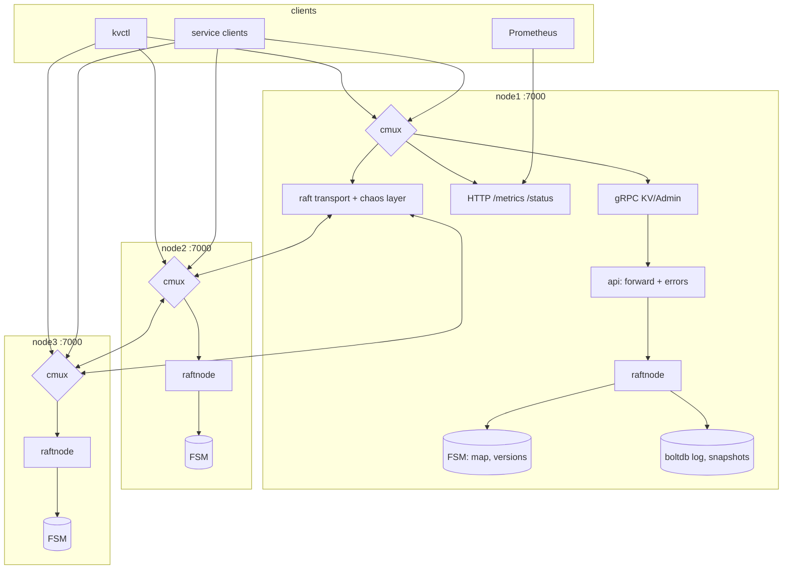
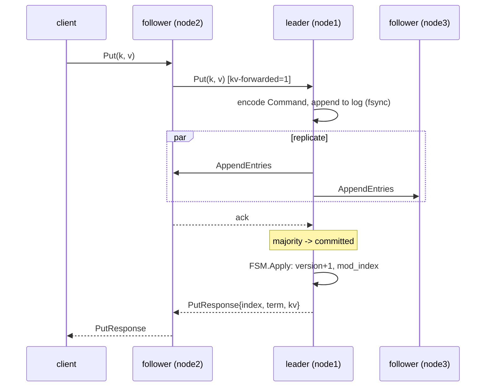
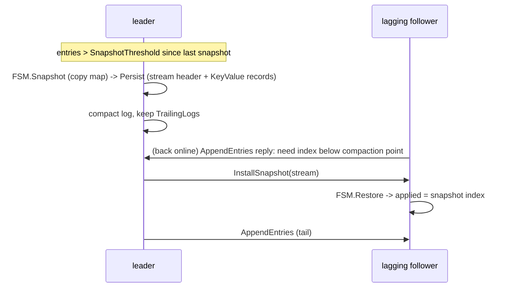

# Diagrams

The exercise requires diagrams made with **Archify** or **Diagram Design**.
These were made with [Archify](https://github.com/tt-a1i/archify) (v3.2):
each diagram is a typed JSON source in [`src/`](src/), validated against
Archify's schema, rendered to a standalone HTML viewer, checked in a real
browser, and then exported from the viewer as a 4x PNG (light theme) and a
dual-theme SVG. The PNG/SVG files below are picked up by the design document
and the GitHub Pages build. The Mermaid sources further down are the
reference for what each diagram must show.

| File | Source | Diagram |
|------|--------|---------|
| `architecture.png/.svg` | `src/architecture.architecture.json` | system architecture (clients, 3 nodes, one port each, raft links, storage) |
| `flow-write.png/.svg` | `src/flow-write.sequence.json` | write path with forwarding, replication, commit, apply |
| `flow-read.png/.svg` | `src/flow-read.sequence.json` | linearizable read path (ReadIndex) and stale read |
| `flow-failover.png/.svg` | `src/flow-failover.sequence.json` | leader crash: election, acknowledged writes, in-flight writes |
| `flow-partition.png/.svg` | `src/flow-partition.sequence.json` | minority partition: lease loss, refusal, heal |
| `flow-snapshot.png/.svg` | `src/flow-snapshot.sequence.json` | snapshot, compaction, InstallSnapshot to a lagging node |

## Rebuilding

```sh
npx skills add tt-a1i/archify -g          # installs ~/.agents/skills/archify
npm install --no-save playwright-core      # drives the viewer's Export menu
export ARCHIFY_CHROME=/path/to/chrome      # any Chromium build
scripts/diagrams.sh
```

`scripts/diagrams.sh` runs `archify finalize` for every source (schema
validation, delivery, a strict artifact check and a headless-browser check;
a non-zero exit means the diagram is rejected) into the git-ignored
`.archify/` directory, then `scripts/diagrams-export.mjs` opens each HTML
viewer and saves the PNG and SVG here. Edit the JSON sources, not the
exports.

Conventions in the sources: `emphasis` arrows are the main request path,
`return` arrows are replies, `dashed` arrows are dropped, failed or
best-effort messages, and `security` arrows are the ones that decide
leadership (VerifyLeader, the AppendEntries that heals a partition). Notes
under a message stand in for Mermaid's `Note over` and self-messages, which
Archify's sequence mode does not draw.

## Architecture



## Write



## Linearizable read (ReadIndex)

```mermaid
sequenceDiagram
    participant C as client
    participant L as leader
    participant Fs as followers
    C->>L: Get(k, LINEARIZABLE)
    alt first read in this term
        L->>Fs: Barrier entry (commit an entry of own term)
        Fs-->>L: ack
    end
    L->>Fs: VerifyLeader heartbeat
    Fs-->>L: ack from majority
    L->>L: commit := CommitIndex(); wait FSM.applied >= commit
    L-->>C: GetResponse{value, version, index}
    Note over C,L: STALE: any node answers from its FSM immediately
```

## Leader failover

```mermaid
sequenceDiagram
    participant C as client
    participant L as leader (old)
    participant A as follower A
    participant B as follower B
    C->>L: Put(k1) ... acked (on majority)
    C->>L: Put(k2) in flight
    Note over L: crash
    Note over A,B: election timeout, A wins (its log has k1)
    C--xL: Put(k2): DeadlineExceeded / connection lost (unknown)
    C->>A: Get(k1) -> found (acked write survived)
    C->>A: Get(k2) -> maybe; client reads back before retrying
```

## Minority partition

```mermaid
sequenceDiagram
    participant C as client
    participant L as leader (isolated)
    participant A as follower A
    participant B as follower B
    Note over L,B: cut: L | {A, B}
    C->>L: Put(x)
    Note over L: no majority ack; lease expires -> steps down
    L-->>C: Unavailable NOT_APPLIED / DeadlineExceeded (never success)
    Note over A,B: elect A at higher term
    C->>B: Put(y) -> forwarded to A -> ok
    Note over L,B: heal
    A->>L: AppendEntries(term+1) -> L truncates x, appends y
    C->>L: Get(y) -> forwarded to A -> found
```

## Snapshot and catch-up


