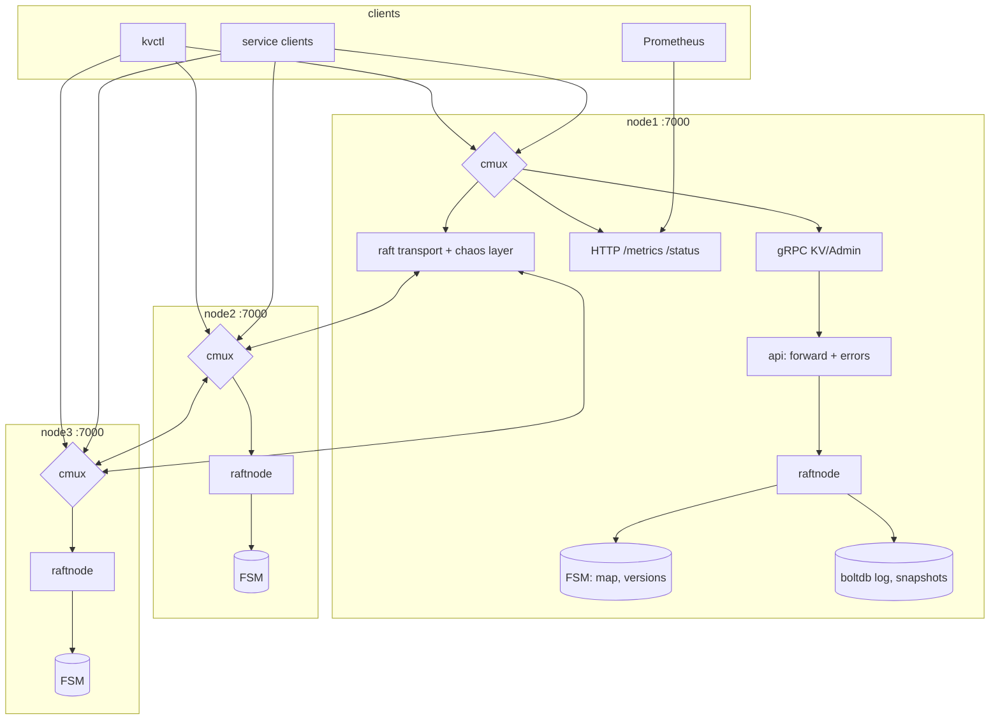
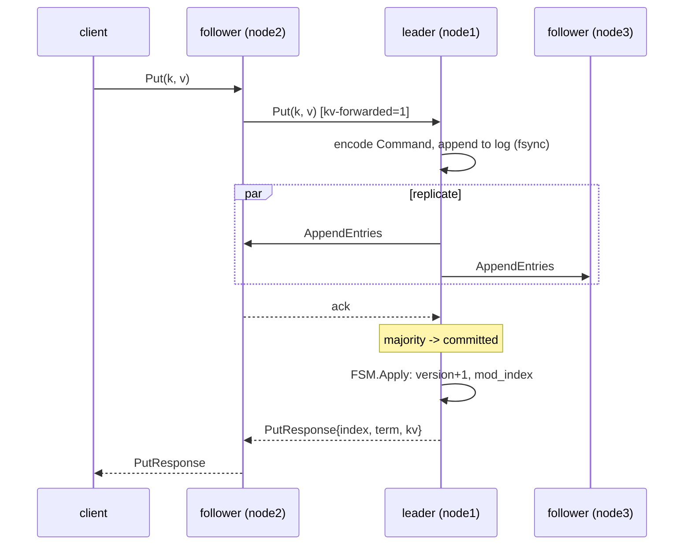
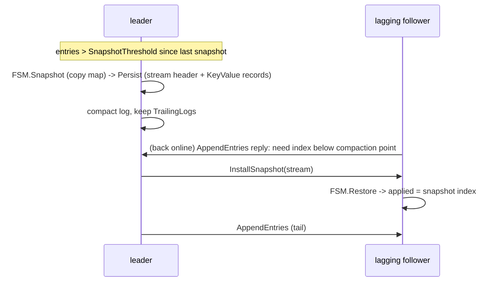

# Diagrams

The exercise requires diagrams made with **Archify** or **Diagram Design**.
Export them here as PNG/SVG with the names below and they are picked up by
the design document and the GitHub Pages build. The Mermaid sources in this
file are the reference for what each diagram must show.

| File | Diagram |
|------|---------|
| `architecture.png` | system architecture (clients, 3 nodes, one port each, raft links, storage) |
| `flow-write.png` | write path with forwarding, replication, commit, apply |
| `flow-read.png` | linearizable read path (ReadIndex) and stale read |
| `flow-failover.png` | leader crash: election, acknowledged writes, in-flight writes |
| `flow-partition.png` | minority partition: lease loss, refusal, heal |
| `flow-snapshot.png` | snapshot, compaction, InstallSnapshot to a lagging node |

## Architecture



## Write



## Linearizable read (ReadIndex)

```mermaid
sequenceDiagram
    participant C as client
    participant L as leader
    participant Fs as followers
    C->>L: Get(k, LINEARIZABLE)
    alt first read in this term
        L->>Fs: Barrier entry (commit an entry of own term)
        Fs-->>L: ack
    end
    L->>Fs: VerifyLeader heartbeat
    Fs-->>L: ack from majority
    L->>L: commit := CommitIndex(); wait FSM.applied >= commit
    L-->>C: GetResponse{value, version, index}
    Note over C,L: STALE: any node answers from its FSM immediately
```

## Leader failover

```mermaid
sequenceDiagram
    participant C as client
    participant L as leader (old)
    participant A as follower A
    participant B as follower B
    C->>L: Put(k1) ... acked (on majority)
    C->>L: Put(k2) in flight
    Note over L: crash
    Note over A,B: election timeout, A wins (its log has k1)
    C--xL: Put(k2): DeadlineExceeded / connection lost (unknown)
    C->>A: Get(k1) -> found (acked write survived)
    C->>A: Get(k2) -> maybe; client reads back before retrying
```

## Minority partition

```mermaid
sequenceDiagram
    participant C as client
    participant L as leader (isolated)
    participant A as follower A
    participant B as follower B
    Note over L,B: cut: L | {A, B}
    C->>L: Put(x)
    Note over L: no majority ack; lease expires -> steps down
    L-->>C: Unavailable NOT_APPLIED / DeadlineExceeded (never success)
    Note over A,B: elect A at higher term
    C->>B: Put(y) -> forwarded to A -> ok
    Note over L,B: heal
    A->>L: AppendEntries(term+1) -> L truncates x, appends y
    C->>L: Get(y) -> forwarded to A -> found
```

## Snapshot and catch-up


